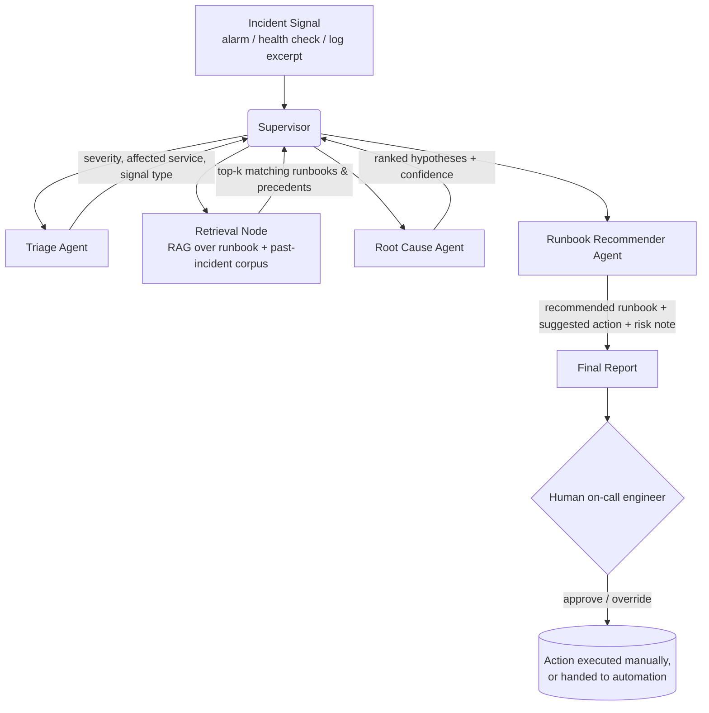

# agentic-infra-ops

**A multi-agent system, built with LangGraph and LangChain, that triages infrastructure
incidents, summarizes probable root cause, and recommends runbook actions from a
retrieval-augmented knowledge base.**

This is a generalized reference implementation of the agent-orchestration patterns used in
production infrastructure-operations work: incident triage, RAG-grounded reasoning, and
human-in-the-loop runbook recommendation, rebuilt from scratch with fully synthetic data
so it is safe to publish and safe to run.

---

## Problem statement

When an infrastructure incident fires (an alarm, a failed health check, a crash-looped
service), an on-call engineer has to do three things quickly, usually under pressure:

1. **Triage**: what is this, how severe is it, what's likely affected?
2. **Diagnose**: what's the probable root cause, based on the signal and any similar past
   incidents?
3. **Act**: which runbook applies, and what's the recommended next step?

This project models that workflow as a small team of cooperating LLM agents instead of one
big prompt, because each step benefits from a different context window, a different
tool, and a different failure mode to guard against. A **supervisor** node routes between
them and decides when the system has enough information to produce a final recommendation.

## Architecture



**Why a graph instead of a single chained pipeline:** the supervisor can loop back to
retrieval if the root-cause agent flags that it doesn't have enough precedent, or stop early
for a high-confidence, low-severity match. This is the actual reason to reach for LangGraph
over a linear LangChain chain: conditional routing and state that persists across agent
calls.

### Components

| Component | File | Role |
|---|---|---|
| Supervisor | `src/agents/supervisor.py` | Routes between agents, decides when triage is complete |
| Triage Agent | `src/agents/triage.py` | Classifies severity, affected component, signal type |
| Retrieval Node | `src/agents/retriever_node.py` | RAG lookup over synthetic runbook + incident corpus |
| Root Cause Agent | `src/agents/root_cause.py` | Produces ranked root-cause hypotheses with confidence |
| Runbook Recommender | `src/agents/runbook_recommender.py` | Maps diagnosis to a concrete recommended action |
| Graph wiring | `src/graph.py` | LangGraph `StateGraph` definition and edges |
| LLM client | `src/llm.py` | Bedrock / Anthropic backend with a deterministic demo-mode fallback |
| Retriever | `src/retrieval.py` | TF-IDF retriever over local Markdown/JSON corpus (no external vector DB required to run the demo) |

## What's a realistic pattern vs. what's simplified for this portfolio

This is the section to read before assuming this maps 1:1 to a production system.

**Realistic / representative of real production patterns:**
- The multi-agent decomposition (triage → retrieval → diagnosis → recommendation) and the
  supervisor-routing structure.
- Treating retrieval as a first-class node that can be re-invoked, not a one-shot RAG call.
- Designing for graceful LLM-credential degradation (see `src/llm.py`); production agent
  systems need to fail predictably, not silently, when a backend is unavailable.
- The shape of the runbook and incident corpus (severity, affected component, signal,
  resolution steps) reflects how this kind of knowledge is actually structured.

**Simplified for portfolio purposes:**
- The runbook/incident corpus (`data/`) is entirely synthetic: fictional services, fictional
  past incidents. No real employer's systems, alerts, or data are represented here.
- Retrieval uses a local TF-IDF index (`scikit-learn`) by default so the project runs with
  zero external dependencies and zero API keys. A production system would more likely use
  Amazon Bedrock Knowledge Bases or a managed vector store (Pinecone, OpenSearch). The
  retriever is intentionally written behind a small interface (`src/retrieval.py`) so
  swapping it for a real vector DB is a contained change, not a rewrite.
- This project does not execute runbook actions. It recommends; a human (or a separate,
  permissioned automation system, see the companion `incident-runbook-automation` repo)
  is in the loop for execution. That separation is deliberate, not a missing feature.

## Tech stack

`Python 3.11` · `LangGraph` · `LangChain` · `Amazon Bedrock` (optional, for real LLM calls)
· `boto3` · `scikit-learn` (TF-IDF retrieval) · `pydantic`

## Setup

```bash
git clone https://github.com/sauharddobhal/agentic-infra-ops.git
cd agentic-infra-ops
python -m venv .venv && source .venv/bin/activate
pip install -r requirements.txt
cp .env.example .env
```

### Running without any credentials (demo mode)

The system detects whether AWS Bedrock or Anthropic API credentials are present. If neither
is found, it runs in **demo mode**: agents still execute the full graph, retrieval still runs
against the real local corpus, but the "LLM" reasoning steps use deterministic, clearly
labeled mock responses instead of a live model call. This is intentional, so anyone cloning
the repo can see the full agent flow end-to-end without needing to provision anything.

```bash
python demo.py --incident "p99 latency on checkout-api jumped from 80ms to 4200ms, ECS tasks restarting"
```

### Running with a real LLM backend

Set one of the following in `.env`:

```bash
# Option A: Amazon Bedrock
AWS_ACCESS_KEY_ID=...
AWS_SECRET_ACCESS_KEY=...
AWS_REGION=us-east-1
BEDROCK_MODEL_ID=anthropic.claude-3-5-sonnet-20241022-v2:0

# Option B: Anthropic API directly
ANTHROPIC_API_KEY=sk-ant-...
```

Then run the same command. `demo.py` will automatically use the live backend instead of
demo mode.

### Running tests

```bash
pytest tests/
```

## Example output (demo mode)

```
$ python demo.py --incident "p99 latency on checkout-api jumped from 80ms to 4200ms, ECS tasks restarting"

[supervisor] routing to triage
[triage]      severity=SEV2  component=checkout-api  signal=latency+restart
[supervisor] routing to retrieval
[retrieval]   matched 2 runbooks, 1 past incident (top score 0.81)
[supervisor] routing to root_cause
[root_cause]  hypotheses:
              1. (0.74) Downstream dependency timeout cascading into task health-check failures
              2. (0.21) Memory pressure causing GC pauses prior to restart
[supervisor] routing to runbook_recommender
[runbook_recommender]
              Recommended: RB-014 "ECS task restart loop: dependency timeout"
              Suggested next step: check downstream RDS connection pool saturation before
              scaling tasks further; scaling will not fix a saturated connection pool.
              Risk note: do not force a deploy rollback until dependency health is confirmed;
              precedent incident INC-0042 shows rollback alone did not resolve this pattern.

[DEMO MODE] No live LLM credentials detected, responses above are deterministic
demo output, not live model generations. See README "Running with a real LLM backend".
```

## Evaluating this system's output

[`llm-eval-harness`](https://github.com/sauharddobhal/llm-eval-harness) can score this
system's actual output (faithfulness, relevance, hallucination risk), not just
synthetic data. Clone it as a sibling directory and run
`python examples/evaluate_agentic_infra_ops.py` from there; it runs this repo's real
graph in demo mode and evaluates the genuine output.

## License

MIT, see `LICENSE`.
